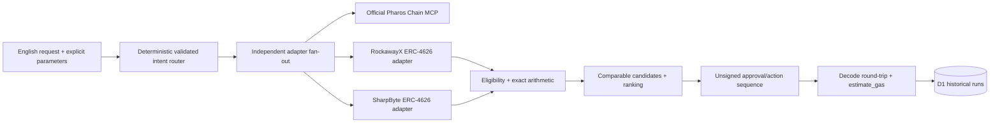

# Architecture

## Purpose and boundary

The aggregator turns one validated request into independently observed venue candidates, an eligibility-aware route, and a reviewable unsigned transaction sequence. It never stores a key, creates a signer, signs, broadcasts, funds an account, or deploys a contract.

## Request interpretation

The public form exposes intent, account, receiver, amount, asset, horizon, objective, minimum output, and optional outage injection. Natural-language text maps only to the four bounded intents `positions`, `compare`, `deposit`, and `withdraw`. Addresses and amounts undergo deterministic validation. Missing or ambiguous account, receiver, amount, asset, or operation returns `NEEDS_INPUT`; nothing is guessed. The implementation does not claim unrestricted LLM planning.

## Adapter interface and protocol differences

`MorphoVaultAdapter` implements configuration validation, position/state/rate reads, eligibility data, deposit and withdrawal preparation, and calldata validation for two independent vault contracts:

- RockawayX USDC V2: `0x047cd0a91e9b92ed979189a6c8a120bf280f02e5`.
- SharpByte USDC Pharos Ecosystem: `0x15c25ED222fc498f672af5c3adb5ED0a96E1AFf1`.

Both are synchronous Morpho Vault V2 ERC-4626 venues with USDC as the verified underlying and 18-decimal shares. They share Morpho protocol and infrastructure; this is disclosed rather than presented as two independent protocols. Centrifuge JTRSY was checked during the foundation gate, but the public account was not permissioned and its redemption lifecycle is asynchronous. It was therefore excluded from executable routing instead of being mislabeled as a completed synchronous action.

## MCP transport and pinned reads

The official hosted Pharos MCP is used through Streamable HTTP. Only `get_chain_info`, `get_block_number`, `get_block`, `get_code`, `eth_call`, `estimate_gas`, and `get_gas_price` are allowlisted. Each related venue snapshot is pinned to one end block. Historical fixed-share conversion uses the same one-share quantity at the pinned end block and exactly 100,000 blocks earlier. Per-adapter timeouts and bounded safe-read retries isolate failures.

## Routing eligibility and ranking

Position queries aggregate every successful adapter. Deposit routing rejects wrong assets, insufficient verified wallet balances, failed adapters, and unreadable quotes. Withdrawal routing rejects venues with zero shares or insufficient converted exposure. Eligible venues are ranked by modeled final USDC value over the supplied horizon, minus explicit per-venue USDC cost assumptions. A lower observed rate can win after costs. Failed venues are excluded with reasons; one remaining venue is called the best available evaluated option, not globally best.

The historical fixed-share metric is an observed vault share-value change, not APY, guaranteed yield, or personal earnings. PROS-denominated gas is not converted to USDC without a verified conversion source. Morpho V2's standard `maxDeposit`, `maxWithdraw`, and related views return zero by design, so the app does not treat zero as capacity. Fresh capacity, liquidity-adapter constraints and gates remain material preconditions.

## Exact arithmetic and comparability

All token values and rate calculations use `BigInt`. USDC uses six decimals; vault shares use eighteen. Position exposure is calculated once with `convertToAssets(balanceOf(account))`; shares and their underlying are displayed together but never added as separate economic assets. The two rate points use identical share quantities and comparable blocks.

## Approval and action sequence

Allowance is read from USDC for the exact selected vault. If insufficient, the first unsigned transaction is a bounded `approve(vault, requestedAssets)`; otherwise approval is omitted. Deposits use `deposit(assets, receiver)`. Asset-first withdrawals use `withdraw(assets, receiver, owner)` only when the verified position can cover the requested assets. Owner, caller and receiver remain explicit. Standard ERC-4626 calls contain no invented slippage field; the UI explicitly notes this absence.

## Validation and freshness

Every prepared calldata value is decoded back and compared with the reviewed request. `estimate_gas` is called without broadcasting. A deposit that depends on a pending approval is `CONDITIONAL`, not fully simulated under hypothetical state. Failed estimates are reported rather than replaced by zero. Plans expire after five minutes and historical reopening never silently re-executes them.

## Failure isolation

Every adapter returns `AVAILABLE` or `UNAVAILABLE` with its own reason and observation time. Promise settlement plus per-adapter timeout prevents one protocol response from erasing the other. The UI outage control injects a failure into exactly one adapter while the healthy adapter still performs genuine Chain MCP reads; the label explicitly says this is a demonstration, not a protocol incident.

## Persistence and workspace separation

This project has its own directory, Cloudflare Worker, static assets and D1 database. A request key makes saved run creation idempotent. Saved payloads are immutable historical observations. Reopening a run marks expired plans without re-running Chain MCP.

## Limitations

- Both selected venues use Morpho; protocol-level correlated risk remains.
- Morpho Vault V2 capacity and withdrawal liquidity require SDK/lens-level calculations beyond standard ERC-4626 max views. The app therefore retains execution-time preconditions and does not make an unconditional capacity claim.
- Gas is shown in native units when estimable and is not converted to USDC.
- Observed share-value history is not guaranteed future performance.
- Public examples are third-party addresses and do not imply project control.
